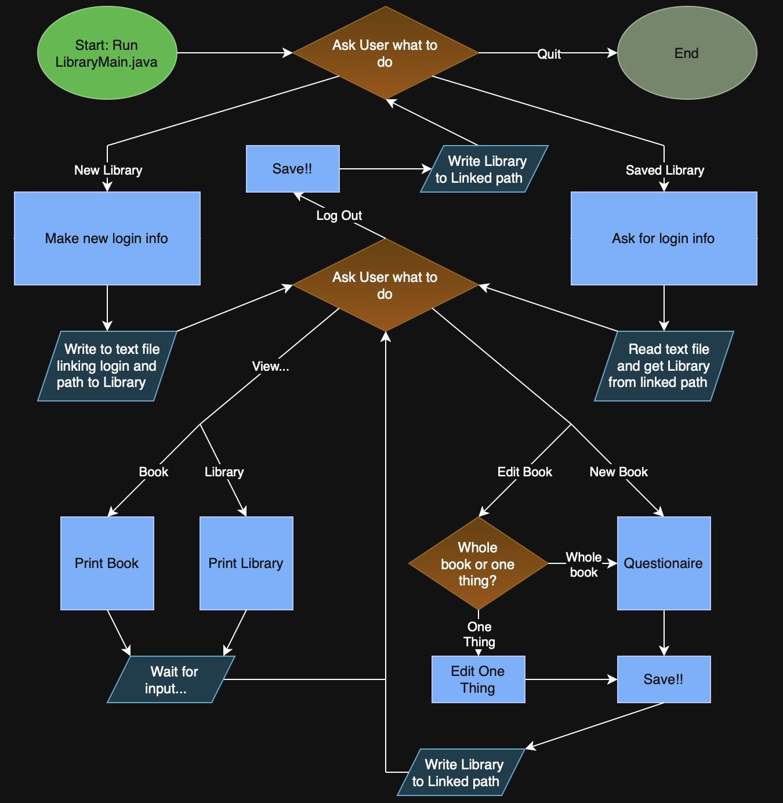

# BookLibrary

Final Project for CSTools - This program is a Library that keeps track of books I've read/am reading/need to read

## Problem

Keeping track of what books I have and haven't read, and what I thought about them.

## How it works



## Tech Stack

- **Language:** Java
- **Libraries:** ISBN
- **External tools:** OpenLibrary or GoogleBooks

## Setup

```bash
git clone https://github.com/you/your-project
cd BookLibrary
java BookLibrary.java
```

## Usage

```bash
java BookLibrary.java
command command command
```
(WIP)

## Roadmap

- [ ] Ratings
- [ ] Tags (Physical/Audible, Owned/Borrowed, etc.)
- [ ] Sorting/Searching
- [ ] Multiple profiles
- [ ] Variable summaries
- [ ] Custom Tags
- [ ] Prices
- [ ] Similar to...

## Author

Xavier Crevier
https://github.com/MxQuestionMark/
