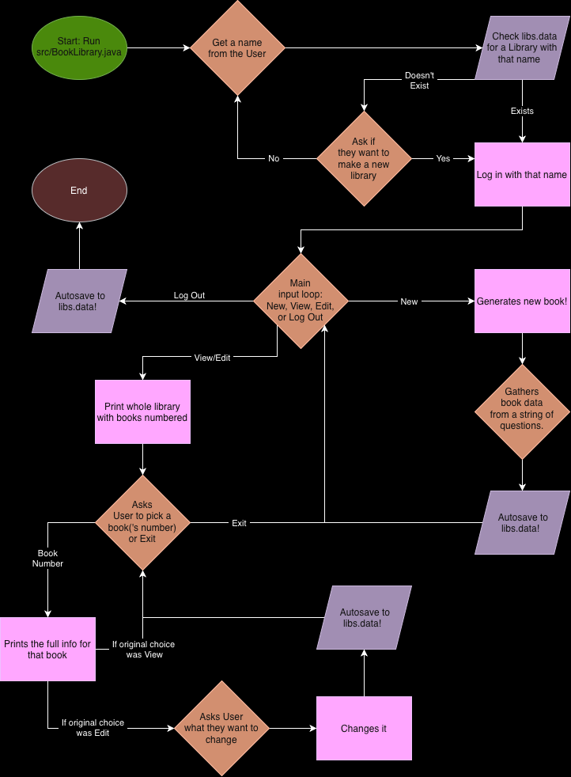

# BookLibrary

Final Project for CSTools - This program is a Library that keeps track of books I've read/am reading/need to read

## Problem

Keeping track of what books I have and haven't read, and what I thought about them.
I have the problem of having too many books that I'm reading all at once, and keeping track of the ones I need to read/have already read. I also struggle remembering things about books I've read in the past.

## How it works



## Tech Stack

- **Language:** Java
- **Libraries:** None
- **External tools:** None

## Setup

```bash
git clone https://github.com/MxQuestionMark/BookLibrary
cd BookLibrary
java src/BookLibrary.java
```

## Usage

After running the file just follow the prompts. It's very self explanatory.
Please never CTRL+C the program as that might cause data loss. Always log out.

## Roadmap

- [ ] Ratings
- [ ] Tags (Physical/Audible, Owned/Borrowed, etc.)
- [ ] Sorting/Searching
- [X] Multiple profiles
- [X] Variable summaries
- [ ] Custom Tags
- [ ] Prices
- [ ] Similar to...

## Author

Xavier Crevier
https://github.com/MxQuestionMark/
